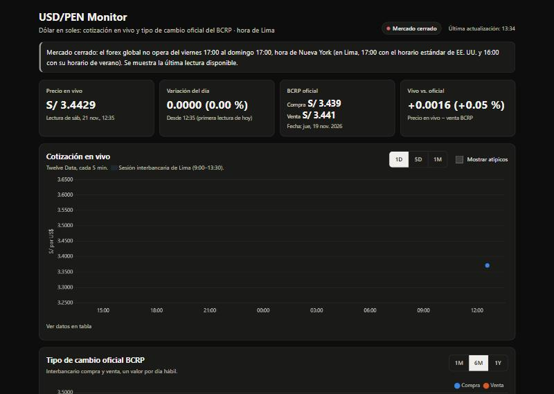
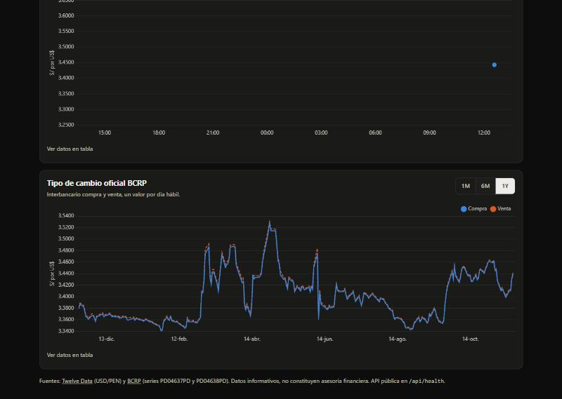
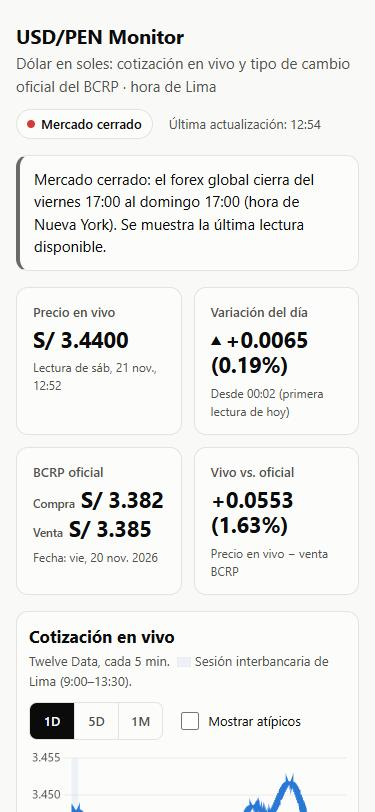
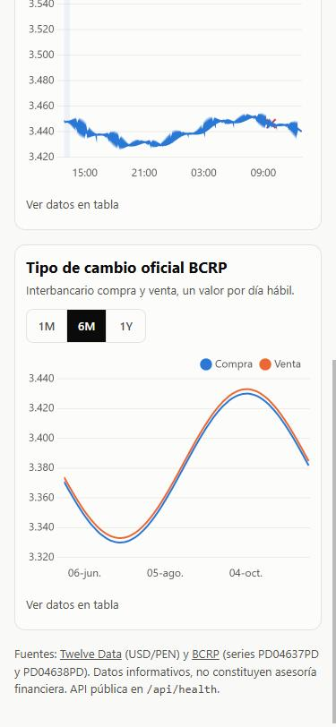
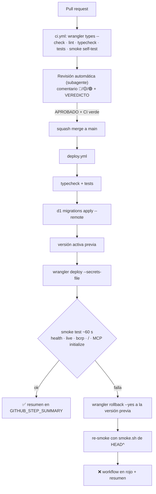

# USD/PEN Monitor

Servicio en **Cloudflare Workers** que registra el tipo de cambio **USD/PEN en vivo** (Twelve Data, cada 5 minutos) y el **tipo de cambio interbancario oficial del BCRP** (compra/venta diario). Incluye dashboard, API REST y servidor MCP. Todo corre en planes gratuitos.

**Producción:** https://usd-monitor.gcs14.workers.dev · API: [`/api/health`](https://usd-monitor.gcs14.workers.dev/api/health) · MCP: `https://usd-monitor.gcs14.workers.dev/mcp`




<details><summary>Vista móvil (datos demo locales)</summary>

 

</details>

## Arquitectura

```mermaid
flowchart LR
  subgraph CF["Cloudflare Worker: usd-monitor"]
    CRON5["Cron */5 * * * *<br/>ingesta live"] --> D1[(D1<br/>live_rates · bcrp_rates · twelve_calls)]
    CRONH["Cron 0 * * * MON-FRI<br/>ingesta BCRP"] --> D1
    ADMIN["POST /admin/fetch<br/>Bearer ADMIN_TOKEN"] --> D1
    API["/api/* REST GET"] --> D1
    MCP["/mcp Streamable HTTP<br/>5 tools solo lectura"] --> D1
    ASSETS["Assets estáticos<br/>dashboard (public/)"] --> API
  end
  TD["Twelve Data /quote"] <-- "1 crédito/llamada<br/>header apikey" --- CRON5
  BCRP["API BCRP<br/>PD04637PD-PD04638PD"] <--- CRONH
  GH["GitHub Actions<br/>manual-fetch.yml"] --> ADMIN
  U["Navegador"] --> ASSETS
  C["Claude / cliente MCP"] --> MCP
```

- **Un solo Worker** sirve el dashboard (assets estáticos), la API, el MCP y los crons. `run_worker_first` manda `/api/*`, `/admin/*` y `/mcp` al código; el resto lo sirven los assets.
- **D1** guarda los datos. Las migraciones son solo aditivas (`migrations/`).

## Fuentes de datos (y por qué dos)

| Fuente                                                     | Qué es                                                                                   | Frecuencia                                                             |
| ---------------------------------------------------------- | ---------------------------------------------------------------------------------------- | ---------------------------------------------------------------------- |
| **Twelve Data** `/quote?symbol=USD/PEN`                    | Cotización de mercado en vivo (puntual)                                                  | Cada 5 min mientras el forex global está abierto                       |
| **BCRP** series `PD04637PD` (compra) y `PD04638PD` (venta) | Tipo de cambio interbancario **oficial**: promedio diario publicado por el banco central | Una vez por día hábil (el cron consulta cada hora los últimos 10 días) |

Son complementarias. La fuente en vivo muestra el movimiento intradía, pero es un proveedor privado y puede traer valores anómalos. La oficial es la referencia regulatoria: llega con retraso y solo en días hábiles. El dashboard y el MCP comparan ambas.

**Detalles verificados:**

- El BCRP devuelve fechas como `20.Nov.26`, con meses en español (septiembre = `Set`), y `"n.d."` cuando no hay dato. Un `n.d.` parcial se guarda como `null` y nunca pisa un valor ya guardado.
- El BCRP responde HTML en vez de JSON a peticiones sin `User-Agent` (los Workers no envían uno), así que se envía uno propio.
- `is_market_open` de Twelve Data no es confiable: el sábado devolvía `true`. El horario se calcula localmente.

## Ingesta en vivo y filtro de anomalías

- **Mercado cerrado:** viernes 17:00 a domingo 17:00, hora de Nueva York. Se calcula con `Intl` en `America/New_York`, así que el cambio de horario EST/EDT se aplica solo. En ese tramo el cron no llama a la API y deja el log `mercado cerrado, sin llamada`.
- **Errores:** ante 429, 5xx, timeout, respuesta vacía o JSON inválido se hace un reintento. Twelve Data reporta errores con HTTP 200 y `status:"error"`. Un fallo nunca rompe el cron.
- **Límite de créditos local** (tabla `twelve_calls`): como máximo 6 por minuto y 750 por día, con margen sobre los 8/min y 800/día del plan. La reserva es una sola sentencia SQL atómica. La lectura forzada del admin ignora el horario de mercado, pero no este límite.
- **Outliers:** una lectura se marca `is_outlier=1` si se desvía más de `OUTLIER_THRESHOLD` (1 %) de la mediana de las últimas `OUTLIER_WINDOW` (12) lecturas válidas de las últimas `OUTLIER_MAX_AGE_SECONDS` (2 h).
  - La antigüedad se mide desde la última lectura guardada, así la muestra del viernes sigue vigente el domingo.
  - Con menos de `OUTLIER_MIN_SAMPLES` (5) lecturas, por ejemplo en el arranque, no se marca nada.
  - Los datos nunca se borran.
  - Ante un cambio de nivel sostenido, el filtro se re-ancla en 2 h o menos.
  - Todos los parámetros son configurables en `[vars]`.
- **Retención:** una vez al día se borran las lecturas en vivo de más de 90 días.

## API REST

GET con `Access-Control-Allow-Origin: *` y cache corto. El preflight `OPTIONS` solo permite métodos de lectura.

| Endpoint                                                 | Descripción                                                                                                           | Cache |
| -------------------------------------------------------- | --------------------------------------------------------------------------------------------------------------------- | ----- |
| `GET /api/health`                                        | `status`, `market_open`, `lima_session_open`, `last_live`, `last_bcrp_date`                                           | 30 s  |
| `GET /api/live/latest`                                   | Última lectura válida (`data: null` si no hay)                                                                        | 60 s  |
| `GET /api/live?range=1d\|5d\|1m[&include_outliers=true]` | Historial. Sin outliers por defecto; con `include_outliers=true` llegan aparte en `outliers`. `1m` se agrupa por hora | 60 s  |
| `GET /api/bcrp/latest`                                   | Último día publicado                                                                                                  | 300 s |
| `GET /api/bcrp?range=1m\|6m\|1y`                         | Historial oficial (`n.d.` → `null`)                                                                                   | 300 s |

- Un parámetro inválido devuelve **400** con la lista de valores `allowed`.
- Un error interno devuelve **503** en JSON con `no-store`.

```bash
curl https://usd-monitor.gcs14.workers.dev/api/live?range=1d
```

## Servidor MCP

`/mcp`: Streamable HTTP sin estado, con `createMcpHandler` de `agents` y `@modelcontextprotocol/server` v2. Es de solo lectura y no expone el endpoint admin. Valida la entrada con Zod y restringe el `Host` (protección contra DNS rebinding).

| Herramienta                | Entrada                                                                      |
| -------------------------- | ---------------------------------------------------------------------------- |
| `get_live_rate`            | —                                                                            |
| `get_live_history`         | `range`: `1d` \| `5d` \| `1m`                                                |
| `get_official_rate`        | `date?` (YYYY-MM-DD). Si ese día no hay dato, devuelve el día hábil anterior |
| `get_official_history`     | `from`, `to` (YYYY-MM-DD, máximo 400 días)                                   |
| `compare_live_vs_official` | — (diferencias contra compra/venta + explicación en español)                 |

**Conectarlo a Claude:**

```bash
# Claude Code
claude mcp add --transport http usd-monitor https://usd-monitor.gcs14.workers.dev/mcp
```

En **Claude Desktop / claude.ai**: Settings → Connectors → _Add custom connector_ → URL `https://usd-monitor.gcs14.workers.dev/mcp`. También se puede probar con el MCP Inspector (`npx @modelcontextprotocol/inspector`, transporte _Streamable HTTP_).

## Endpoint admin y lectura forzada

`POST /admin/fetch?source=live|bcrp|bcrp-backfill` con `Authorization: Bearer <ADMIN_TOKEN>`.

- El token se compara en tiempo constante (SHA-256 + `timingSafeEqual`). Sin token válido, o si `ADMIN_TOKEN` no está configurado, responde **401**.
- No aparece en el dashboard ni en el MCP.

El workflow **`manual-fetch.yml`** (`workflow_dispatch`) lo llama desde GitHub. El valor por defecto `live+bcrp` hace una lectura de cada fuente; `bcrp-backfill` carga 400 días.

## Secrets

| Nombre                  | Dónde           | Uso                                                                                                |
| ----------------------- | --------------- | -------------------------------------------------------------------------------------------------- |
| `TWELVE_DATA_API_KEY`   | GitHub → Worker | API key de Twelve Data                                                                             |
| `ADMIN_TOKEN`           | GitHub → Worker | Bearer de `/admin/fetch` y de `manual-fetch.yml`. Generado con CSPRNG (32 bytes); nunca se imprime |
| `CLOUDFLARE_API_TOKEN`  | GitHub          | Plantilla "Edit Cloudflare Workers" + D1 Edit                                                      |
| `CLOUDFLARE_ACCOUNT_ID` | GitHub          | Cuenta de Cloudflare                                                                               |

- **Rotar `ADMIN_TOKEN`:** generar un valor nuevo y guardarlo con `gh secret set ADMIN_TOKEN --body <valor>`, sin pasarlo por un pipe de PowerShell (agrega CRLF y el token deja de coincidir). Luego volver a ejecutar `deploy.yml`.
- Ningún secret vive en el código, en `wrangler.toml`, en los logs ni en el historial de git.

## Tests

```bash
npm ci
npm run check    # ESLint + Prettier + tsc --noEmit + Vitest (135 tests)
```

Vitest corre dentro del runtime de Workers (`@cloudflare/vitest-plugin`), con una D1 local y aislada a la que se aplican las migraciones reales. Todas las llamadas externas están mockeadas. Qué cubre:

- **BCRP:** parser de fechas (incluido `Set`), bisiestos y `n.d.`.
- **Horario de mercado:** viernes y domingo con EST y EDT, días de cambio de horario y bordes UTC/Nueva York.
- **Outliers:** arranque, umbral, ventana, cambio de nivel sostenido y fin de semana.
- **Admin:** 401 en todas sus variantes y 200/400/429/502.
- **API REST:** con D1 de test, incluidos CORS y cache.
- **MCP:** cliente JSON-RPC: `initialize`, `tools/list`, las 5 herramientas, validación y `Host`.
- **Créditos y reintentos.**

`bash scripts/smoke.sh --selftest` valida los parsers del smoke test sin red; corre en CI.

## CI/CD



- **`main` protegido:** check `ci` obligatorio, sin force-push ni borrado, historial lineal y solo squash merge.
- **Flujo de cada PR:** rama `feat/`, `fix/`, `chore/` o `docs/` → CI → revisión de un subagente independiente con contexto limpio (máximo 3 rondas) → merge solo con CI verde y `VEREDICTO: APROBADO`.
- **Prueba de rollback documentada:**
  1. [#9](https://github.com/Arzule/usd-monitor/pull/9) rompió `/api/health` a propósito, solo en el host de producción.
  2. El [deploy](https://github.com/Arzule/usd-monitor/actions/runs/44935839768) dio: smoke ❌ → `wrangler rollback` ✅ → re-smoke ✅. Workflow en rojo con resumen.
  3. [#10](https://github.com/Arzule/usd-monitor/pull/10) lo revirtió y el deploy volvió a verde.
- **Otros workflows:**
  - `setup-d1.yml`: crea la D1 si no existe.
  - `manual-fetch.yml`: lectura forzada.
  - `cron-logs.yml`: `wrangler tail` de los eventos `scheduled`, para verificar el cron.
  - `connectivity-check.yml`: Fase 0.

## Skills de diseño usadas

- **`dataviz`:** forma del gráfico, color por función, paleta validada con `validate_palette.js` (light y dark: ALL CHECKS PASS), marcas finas, leyenda solo con más de una serie, crosshair y tooltip, tabla alternativa.
- **`break-ui`:** peores casos realistas (`n.d.`, sin datos, 1 punto, API o CDN caídos, 320–375 px, cifras tabulares).

No se cargaron `frontend-design`, `frontend-ui-engineering`, `emil-design-eng` ni `mobile-native` (por límite de contexto de la sesión). Sus temas (responsive, objetivos táctiles, accesibilidad) se cubrieron con la revisión de accesibilidad y legibilidad del PR [#7](https://github.com/Arzule/usd-monitor/pull/7) (3 rondas).

## Decisiones técnicas

- **Commit inicial vacío en `main`**, para que existiera la rama por defecto y se pudiera ejecutar `workflow_dispatch`.
- **Sin `wrangler whoami` en CI:** imprime el email de la cuenta en logs públicos. Se valida el token con la API (`/user/tokens/verify` y `/accounts/{id}`). Además, los logs de wrangler pasan por `scripts/redact-log.sh`.
- **`/quote` en vez de `/price`:** cuesta lo mismo (1 crédito) y trae `last_quote_at`, que es la clave natural de cada lectura.
- **Horario de mercado propio**, por la falta de fiabilidad de `is_market_open`.
- **`wrangler deploy --secrets-file`** en lugar de `wrangler secret put`. `secret put` publica una versión nueva por cada secret; `--secrets-file` sube código y secrets en la misma versión, así el rollback restaura una versión coherente. El archivo se crea en `RUNNER_TEMP` con `umask 077` y se borra con `trap`.
- **Rollback:** se usa la versión al 100 % anterior al deploy. Solo "has no deployments" o el error 10007 (Worker inexistente) cuentan como primer deploy.
  - El re-smoke usa el `smoke.sh` de `HEAD^`, porque el del commit nuevo puede exigir endpoints que la versión restaurada no tiene.
  - El repo es squash-only para que `HEAD^` sea siempre el despliegue anterior.
- **2 Cron Triggers** de los 5 que permite el plan Free.
- **Constantes de cron en `src/crons.ts`:** el módulo principal de un Worker solo puede exportar handlers, y `wrangler dev` falla en caso contrario.
- **TypeScript fijado en `~6.0.3`**, porque typescript-eslint 8.73 exige `<6.1`.
- **`@cloudflare/vitest-plugin`** (sucesor de vitest-pool-workers), con `exports`/`env` de `cloudflare:workers`.
- **D1:**
  - Los INSERT van en bloques de 25 filas (límite de 100 parámetros por consulta).
  - D1 enlaza los números como REAL, por eso la agrupación horaria usa `CAST`.
  - La reserva de créditos es un `INSERT … SELECT … WHERE COUNT < N` atómico.
- **El MCP crea un servidor por petición** (factory sin estado), como recomienda Cloudflare.

## Límites del plan gratuito

| Recurso           | Límite                              | Uso                                                     |
| ----------------- | ----------------------------------- | ------------------------------------------------------- |
| Twelve Data Basic | 8 créditos/min, 800/día             | ≤ 288/día (cron), con tope local de 6/min y 750/día     |
| Workers Free      | 100 k req/día, 10 ms CPU/invocación | Dashboard + API + crons, muy por debajo                 |
| Cron Triggers     | 5 por cuenta                        | 2                                                       |
| D1 Free           | 5 M filas leídas/día, 5 GB          | El rango `1m` lee ~9 k filas por petición (ver mejoras) |

## Validación pendiente (lunes)

Este build se hizo un sábado con el mercado cerrado. El lunes hay que verificar:

1. El cron de 5 min guarda lecturas desde la apertura del domingo 17:00 NY: `/api/live?range=1d` crece cada 5 min.
2. Los logs pasan de `mercado cerrado, sin llamada` a `[live] guardado …`. Se puede verificar con `cron-logs.yml`.
3. El cron horario del BCRP agrega el dato del viernes 20 y del lunes, que el sábado figuraban como `n.d.` o aún no estaban publicados.
4. El filtro de outliers con datos reales: ninguna lectura normal marcada como atípica.
5. El consumo de créditos en el panel de Twelve Data: unos 12 por hora.
6. La banda de sesión de Lima (9:00–13:30, según la nota metodológica del BCRP; el 24 y el 31 de diciembre hasta las 12:00). Los feriados peruanos no se excluyen.

## Mejoras sugeridas

- **Revisor como GitHub Action** (por ejemplo, Claude Code Action), en lugar de un subagente local.
- **Rama `develop` con staging:** un Worker `usd-monitor-staging` con su propia D1, donde se ejecuten el smoke y el simulacro antes de producción.
- **Presupuesto D1 del rango `1m`:** precalcular agregados horarios desde el cron, o aplicar rate limiting por IP. `caches.default` no aplica en `*.workers.dev`.
- **Re-anclaje del filtro de outliers:** re-anclar cuando las últimas K lecturas sean todas atípicas, en vez de esperar a que pase el tiempo.
- **Dashboard:**
  - extraer `withGaps` y la lógica de fechas a un módulo ES con tests;
  - que el botón de reintento pase por `safe()`;
  - `aria-live` más acotado;
  - calendario de feriados para la banda de sesión.
- **MCP:**
  - tests de `get_live_history` con `5d` y `1m`, y de todas las ramas de `explain()`;
  - detectar SSE con `/^data:/m` en el smoke.
